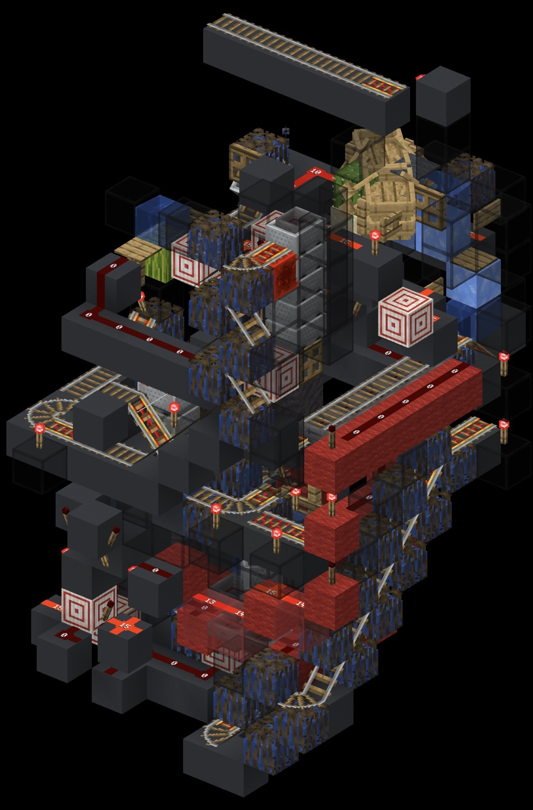

<!-- update-timestamp: 2026-11-09T23:18:33.564000+00:00 -->
**[SSF 8x Ideal Splitter Core + Loader (WIP)](<https://www.youtube.com/watch/Gv0Y_W1Yq0E>)**

Ok so this is exactly what is says on the tin. It’s a SSF ideal splitter that is 8x. Switching item types takes a cycle so 64gt dead time between item types but other than that it’s pretty decent. It can be FHL with some logic to detect when it stops which I plan to add. The loader needs counter logic so it knows when 28 carts have been sent to it so it can be replaced. (Not 27 because it would result in 1727 items not 1728) this is something I’m yet to add but apart from those two things it’s basically done.. it also needs calling for empty carts from the empty cart storage but that’s super simple and not necessarily needed to call it complete (it’s a redstone line and a rail) if anyone has any questions about it feel free to ask :)

the link is the demo of it I posted to yt

[View Discord message](https://discord.com/channels/1411133575650213905/1533211005889282208/1569491417045401692)

## Media

