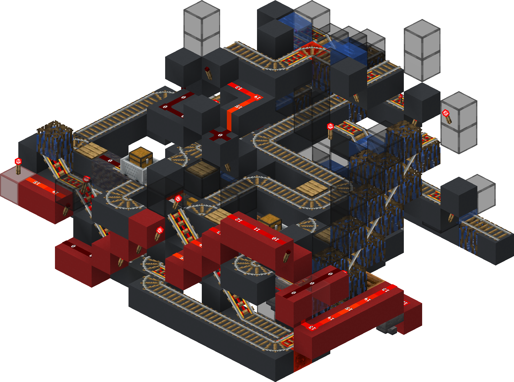
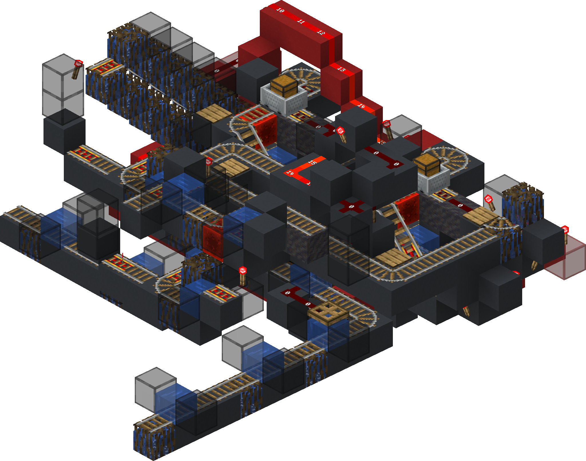

<!-- update-timestamp: 2026-11-19T00:39:26.961000+00:00 -->
**Splitter Nonstackable filtering**

It’s hella messy but it works and I don’t care. To explain what’s happening here I think it’s best to just explain the flow. 

```ansi
[1;37m Splitter Non-Stackable Remover Logic
          │
          │
    Splitter Output
          │
          │
   Is Fill Level ≤ 1?
     ├── YES
     │    │
     │    Continue to
     │    Empty Check
     │
     └── NO
          │
          Send Cart to Output
          │
          │
      Is Cart Empty?
     ├── YES
     │    │
     │    Send Cart to
     │    Empty Output
     │
     └── NO
          │
          Continue to
          Non-Stackable
          Removers
          │
          │
   Non-Stackable Removers
   (2 Used to Handle Maximum
   Output of 64 GT per Cart,
   Especially with Multiple
   Single-Item Stacks in a Row)
          │
          │
      Is Cart Empty?
     ├── YES
     │    │
     │    Send Cart to
     │    Empty Cart Output
     │
     └── NO
          │
          Send Cart to Output
 ```

Empty carts get sent directly back to the empty cart storage

[View Discord message](https://discord.com/channels/@me/1520002350708686899/1572776237917675530)

## Media



